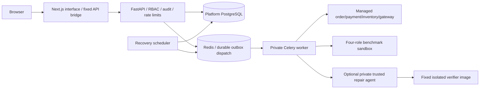

# Architecture

The browser never receives an operator credential. Next serves thirteen workspaces and forwards only explicit REST paths. FastAPI versioned contracts are in `docs/openapi.json`; generated TypeScript is in `frontend/src/types/api.generated.ts`. API/worker share SQLAlchemy models and Alembic migrations 0001–0003. Artifact payloads are immutable canonical JSON, hash addressed and bounded to 256 KiB, stored in the platform database. Back up the database to preserve evidence.

Phase 1 service registration is a typed logical allowlist, not a URL scanner. Registered graph nodes/operations, dependency edges and workflow relationships are explicit operator assertions. Tracing does not prove graph completeness. Authorized adapters collect authoritative state; pure typed invariant rules evaluate equality, implication, transitions and postconditions. The orchestrator supplies bounded retry/consistency windows. Missing state yields INCONCLUSIVE and no finding.

Phase 1 lifecycle: CREATED → QUEUED → RUNNING → VERIFYING → COMPLETED/FAILED/CANCELLED. Research lifecycle omits VERIFYING and has separate outcome fields. COMPLETED means computation ended, not that invariants or patches passed. Database outbox/republication, atomic claims, fencing and sandbox leases protect retries and restarts. Scheduler recovers expired work; it does not replay business side effects. Fault TTLs and namespace isolation bound effects independently of worker health.

Compose partitions edge, platform, sandbox and control networks. Only loopback 3000/8000 are published; database, Redis, fault ports and agent have none. Workers reach sandbox/control; API does not. Native development is loopback-only with SQLite and real Redis/Celery and is not the deployment topology. No ordinary worker/API has Docker access. The optional trusted agent has Docker daemon access and therefore requires its own isolated disposable host/VM.

Research extension points separate planning, execution, observations, minimization, hypotheses, policy proposals and independent verification. The six-policy AST repair format is intentionally bounded. See `docs/PHASE3.md` for algorithms, table names, leases, deadlines and exact APIs; Phase 4 adds `/api/v1/session`, admin audit, per-job trials and research overview counters without removing previous contracts.
